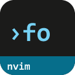
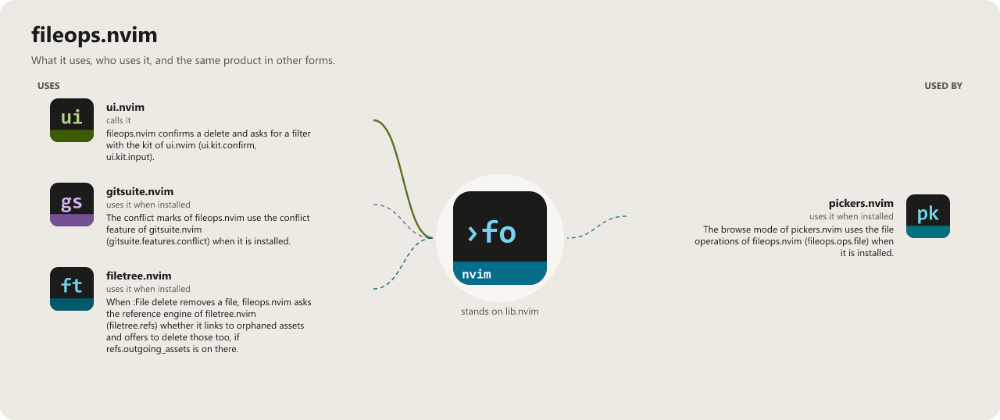

> **Beta stage — active development.** This repository is past its first shape and in
> active use, but the surface is not frozen: breaking changes are still possible. Pin a
> commit or tag if you depend on it.

# fileops.nvim

```
 ███████╗██╗██╗     ███████╗ ██████╗ ██████╗ ███████╗
 ██╔════╝██║██║     ██╔════╝██╔═══██╗██╔══██╗██╔════╝
 █████╗  ██║██║     █████╗  ██║   ██║██████╔╝███████╗
 ██╔══╝  ██║██║     ██╔══╝  ██║   ██║██╔═══╝ ╚════██║
 ██║     ██║███████╗███████╗╚██████╔╝██║     ███████║
 ╚═╝     ╚═╝╚══════╝╚══════╝ ╚═════╝ ╚═╝     ╚══════╝
                                               .nvim
```

[](LICENSE)
[](https://neovim.io)
[](https://www.lua.org)

[](https://wkdsteve.github.io/wkd/p/fileops/)

> Part of the [wkd](https://wkdsteve.github.io/wkd/) family — see this plugin's [page](https://wkdsteve.github.io/wkd/p/fileops/) on the site.

File operations for Neovim — one command, all operations. `:File` creates,
navigates, renames, duplicates and deletes files, keeping the buffer and the
disk in agreement, with all I/O going through libuv directly rather than a
shell.

---

## Documentation

Start at [docs/README.md](docs/README.md) — what's where, and which question
each page answers.

### The Basics

- [Requirements](docs/installation.md#requirements) — Neovim version, required and optional plugins.
- [Installation](docs/installation.md) — every plugin manager.
- [Quickstart](docs/quickstart.md) — the first thing to run after installing.

### What it does

- [Features](docs/FEATURES/README.md) — one page per area, with the reasoning behind each.
- [Around it](docs/around-it.md) — how this plugin's scope differs from its siblings in the collection.

### Configuration & Commands

- [All options](docs/configuration.md) — every `setup()` option and its default.
- [Commands](docs/commands.md) / [Bindings cheatsheet](docs/BINDINGS.md) — full usage and examples for every `:File` subcommand.
- [Keymaps](docs/keymaps.md) — the bindable action surface, for wiring your own keys.
- [Autocommands](docs/autocommands.md) — the `User FileopsChanged` event and what fires it.
- [Lua API](docs/api.md) — calling fileops.nvim functions directly from Lua.

### The Rest

- [Integrations](docs/FEATURES/INTEGRATIONS.md) — context menu, explorer refresh, which-key labels.
- [Health check](docs/FEATURES/INTEGRATIONS.md#checkhealth-fileops) — what `:checkhealth fileops` reports.
- [Architecture](docs/architecture.md) — module layout and responsibilities.
- [Contributing](docs/CONTRIBUTING.md) — ground rules, project layout, and how to add a subcommand.
- [Feedback](https://github.com/WKDSteve/fileops.nvim/issues) — bugs, features, usage questions (or a [discussion](https://github.com/WKDSteve/fileops.nvim/discussions) for anything more open-ended).

`:help fileops` is the same reference inside the editor.

---

## License

MIT — see [LICENSE](LICENSE).

<!-- connections:begin (written by the app-icons tool of the workshop; change integrations.json there, not this block) -->
## Connections



**Uses**

- [filetree.nvim](https://github.com/WKDSteve/filetree.nvim): When `:File delete` removes a file, fileops.nvim asks the reference engine of filetree.nvim (`filetree.refs`) whether it links to orphaned assets and offers to delete those too, if `refs.outgoing_assets` is on there. ([picture](assets/graphs/pair/fileops.nvim--filetree.nvim.png))
- [gitsuite.nvim](https://github.com/WKDSteve/gitsuite.nvim): The conflict marks of fileops.nvim use the conflict feature of gitsuite.nvim (`gitsuite.features.conflict`) when it is installed. ([picture](assets/graphs/pair/fileops.nvim--gitsuite.nvim.png))
- [ui.nvim](https://github.com/WKDSteve/ui.nvim): fileops.nvim confirms a delete and asks for a filter with the kit of ui.nvim (`ui.kit.confirm`, `ui.kit.input`). ([picture](assets/graphs/pair/fileops.nvim--ui.nvim.png))
- [lib.nvim](https://github.com/WKDSteve/lib.nvim): the shared base of the plugins.

**Used by**

- [pickers.nvim](https://github.com/WKDSteve/pickers.nvim): The browse mode of pickers.nvim uses the file operations of fileops.nvim (`fileops.ops.file`) when it is installed. ([picture](assets/graphs/pair/pickers.nvim--fileops.nvim.png))
<!-- connections:end -->
